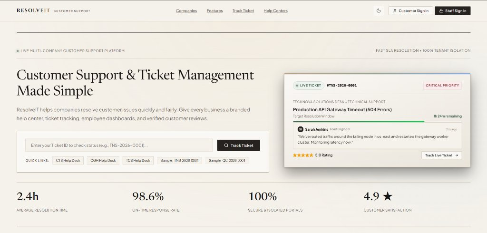
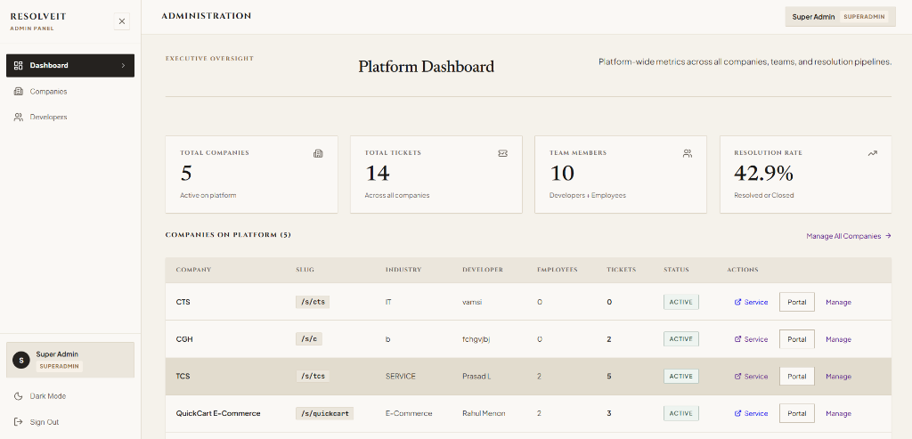
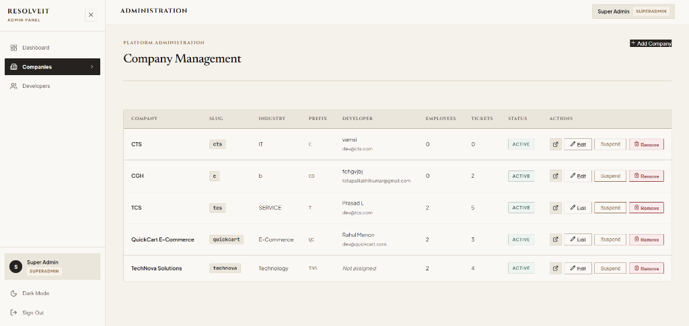
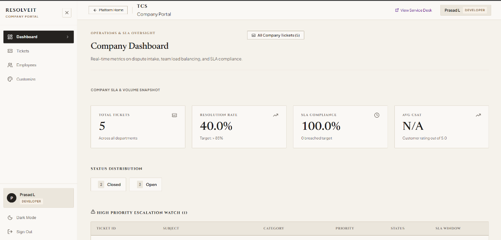
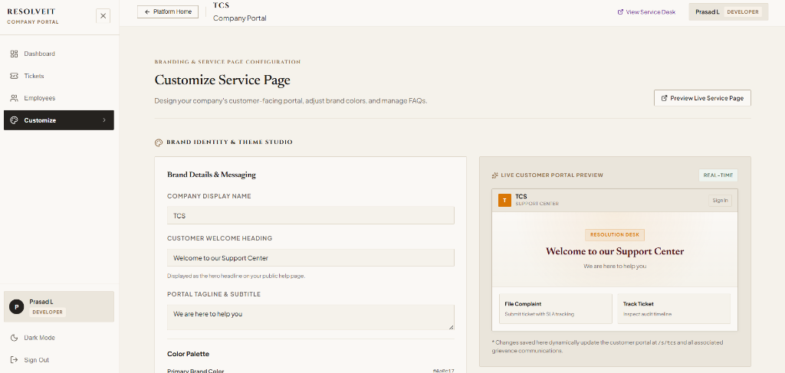
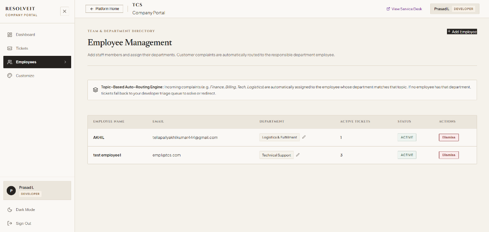
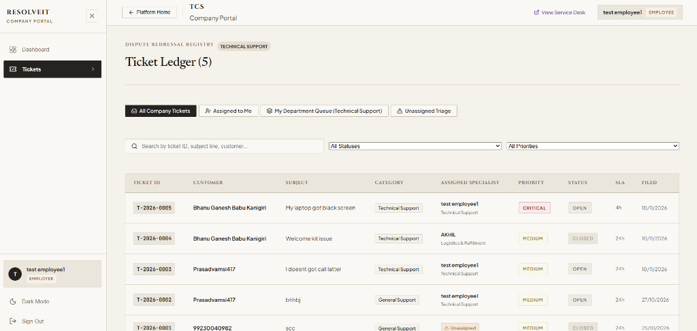

# ResolveIT - Multi-Tenant Customer Support & Grievance Redressal Platform

> **Live Production Deployment**: [https://resolveit-delta.vercel.app/](https://resolveit-delta.vercel.app/)  
> **Architecture**: Multi-Tenant SaaS Customer Support & Dispute Resolution Platform (MongoDB Atlas, Express.js, React 19, Node.js).

ResolveIT is a modern web application that lets multiple companies run their own completely independent, branded customer help desks from a single codebase and database. Think of it like Zendesk or Freshdesk, but lightweight, fast, and designed with clear boundaries between businesses.

Every company gets its own web link (like `/s/tcs` or `/s/technova`), its own custom brand colors, its own FAQs, its own staff members, and its own support tickets. Company staff can never see tickets from another company, and customers get a clean, simple page where they can submit complaints, track ticket progress in real-time, and rate the resolution when it's done.



---

## How It Works (The Big Picture)

Imagine you run an IT company (like TCS) and you have hundreds of customers using your software. When something breaks:
1. **The customer** visits `https://resolveit-delta.vercel.app/s/tcs`, searches common questions, and if they still need help, logs in with Google and submits a ticket.
2. **The system** automatically inspects the complaint topic (for example, *Technical Support* vs. *Finance & Billing*) and instantly sends it to the right support employee's desk.
3. **The support employee** logs into their internal portal (`/portal/tcs`), sees the ticket with a live countdown timer showing their deadline, chats with the customer, and adds private notes only teammates can read.
4. **The customer** receives an automated email confirmation with their unique tracking number (e.g., `T-2026-0005`) and can check on it anytime without needing a password.
5. **Once fixed**, the ticket is marked *Resolved*, the customer receives a closing email, and they can rate the help they received with 1 to 5 stars.
6. **The Super Admin** watches everything from a master control dashboard (`/admin`), viewing total tickets across all companies, on-time resolution percentages, and company growth.

---

## Visual Tour & System Architecture

Our system is organized around four clear roles: **Super Admin**, **Company Developer**, **Support Employee**, and **Customer**. Here is how each part of the platform looks and operates.

```
                  ┌─────────────────────────────────┐
                  │    Super Admin (Platform Owner)  │
                  │   - Adds companies & developers │
                  │   - Monitors global platform health│
                  └────────────────┬────────────────┘
                                   │
              ┌────────────────────┴────────────────────┐
              ▼                                         ▼
   ┌──────────────────────┐                  ┌──────────────────────┐
   │ TCS Company Developer│                  │ QuickCart Developer  │
   │ - Sets brand colors  │                  │ - Sets brand colors  │
   │ - Manages employees  │                  │ - Manages employees  │
   │ - Triage queue       │                  │ - Triage queue       │
   └──────────┬───────────┘                  └──────────┬───────────┘
              │                                         │
              ▼                                         ▼
   ┌──────────────────────┐                  ┌──────────────────────┐
   │   TCS Support Staff  │                  │ QuickCart Support    │
   │ (emp1@tcs.com, etc.) │                  │ (marcus@quickcart)   │
   │ - Answers tickets    │                  │ - Answers tickets    │
   │ - Department queue   │                  │ - Department queue   │
   └──────────────────────┘                  └──────────────────────┘
              ▲                                         ▲
              │                                         │
   ┌──────────┴───────────┐                  ┌──────────┴───────────┐
   │ Customer at /s/tcs   │                  │ Customer at /s/qc    │
   │ - Logs in with Google│                  │ - Logs in with Google│
   │ - Files complaints   │                  │ - Files complaints   │
   └──────────────────────┘                  └──────────────────────┘
```

---

### 1. Super Admin (Platform Owner)
- **Who this is**: The master platform owner running the ResolveIT network.
- **Where they log in**: `https://resolveit-delta.vercel.app/admin`
- **What they can do**:
  - **Platform Executive Dashboard**: Live counts of total companies, total tickets across all businesses, registered team members, and the global resolution percentage.
  - **Company Directory & Management**: View every onboarded company, their assigned developer, employee headcounts, and ticket load. Add new companies or suspend/activate existing businesses with one click.
  - **Developer Access Provisioning**: Create and assign Company Developer accounts for new businesses.
  - **Direct Access**: Jump directly into any company's public service desk or internal staff portal.

#### Super Admin Platform Dashboard


#### Super Admin Company Management Console


---

### 2. Company Developer (Company Lead / Admin)
- **Who this is**: The technical lead or support manager for a specific business (e.g., *Prasad L* managing *TCS*).
- **Where they log in**: `https://resolveit-delta.vercel.app/portal/tcs`
- **What they can do**:
  - **Company Operations Dashboard**: Monitor company-specific ticket counts, current resolution rate, SLA compliance score (e.g. 100%), and status distribution (*Closed*, *Open*, *Escalated*).
  - **Brand Identity & Theme Studio**: Customize company display name, welcome heading, tagline, and pick exact brand colors (Primary & Accent) with a live, real-time preview of how customers will see their desk.
  - **Employee Team Roster**: Add new support employees, assign their department (*Technical Support*, *Logistics & Fulfilment*, *Billing Support*), and dismiss employees when needed.
  - **Knowledge Base (FAQs)**: Add, edit, reorder, and toggle visibility for frequently asked questions so customers can solve common problems without opening a ticket.
  - **Developer Triage Queue**: If a complaint is filed in a category that has no active employee yet, it automatically lands in the Developer's triage queue so no customer is ever left unanswered. The developer can resolve it personally or reassign it.

#### Developer Operations & SLA Dashboard (TCS)


#### Brand Identity Studio & Live Preview Customizer


#### Employee Directory & Department Assignment


---

### 3. Support Employee (Department Specialist)
- **Who this is**: Frontline customer support engineers (e.g., `emp1@tcs.com` assigned to *Technical Support* at TCS).
- **Where they log in**: `https://resolveit-delta.vercel.app/portal/tcs`
- **What they can do**:
  - **Personalized Desk**: See their direct caseload, active department queue, and resolved tickets with their department badge (*Technical Support*).
  - **Ledger Scope Tabs**: Fast switching between four views:
    - *All Company Tickets*: Complete overview of company disputes.
    - *Assigned to Me*: Cases personally allocated to this agent.
    - *My Department Queue*: Open cases matching their department (e.g., laptop crashes, login issues).
    - *Unassigned Triage*: Inbound complaints waiting for an agent.
  - **Live Ticket Workspace**:
    - Chat directly with the customer in a public thread.
    - Write private internal team notes (highlighted with distinct borders) that only staff can see — customers never see internal notes.
    - Update case status (*Open*, *In Progress*, *Resolved*, *Closed*).
    - Track dynamic SLA countdown timers (e.g., Critical tickets must be answered in 4 hours).

#### Employee Ticket Ledger & Queue Tabs


---

### 4. Customer (Public User)
- **Who this is**: Any client, user, or consumer who needs assistance from a specific company.
- **Where they go**: `https://resolveit-delta.vercel.app/s/tcs` (or `/s/technova`, `/s/quickcart`)
- **What they can do**:
  - **Read FAQs**: Search questions categorized by topic (Billing, Technical, General) without needing to log in.
  - **Sign In with Google**: One-click login using standard Google OAuth 2.0. Their name, email, and avatar are automatically verified.
  - **File a Complaint**: Fill out a clean, validated complaint form:
    - Choose Category & Urgency Priority (Low, Medium, High, Critical).
    - Incident Date (constrained to past or present dates only).
    - Detailed description and optional file attachments.
  - **Track Ticket Without Password**: Customers can enter their Ticket ID (e.g., `T-2026-0005`) into the public tracker and view live milestone progress and agent public replies. All internal notes, staff emails, and developer routing logs are shielded from the public for privacy.
  - **My Complaints Dashboard**: Logged-in customers can view their entire complaint history, reply back to support agents, and leave a 1 to 5 star rating once their issue is resolved.

---

## Seeded Login Credentials

Use these verified test accounts to explore each role on the live production site:

| Role | Company | Email | Password | Access URL | What to Test |
|---|---|---|---|---|---|
| **Super Admin** | Platform Master | `admin@resolveit.com` | `password123` | [Open `/admin`](https://resolveit-delta.vercel.app/admin) | Add new companies, create developers, monitor all platform stats |
| **TCS Developer** | TCS | `dev@tcs.com` | `password123` | [Open `/portal/tcs`](https://resolveit-delta.vercel.app/portal/tcs) | Customize TCS brand colors, hire employees, manage FAQs & triage |
| **TCS Employee** | TCS (Tech Support) | `emp1@tcs.com` | `password123` | [Open `/portal/tcs`](https://resolveit-delta.vercel.app/portal/tcs) | View Technical Support queue, reply to tickets, add team notes |
| **TechNova Developer** | TechNova Solutions | `dev@technova.com` | `password123` | [Open `/portal/technova`](https://resolveit-delta.vercel.app/portal/technova) | TechNova company portal management |
| **QuickCart Developer** | QuickCart E-Commerce | `dev@quickcart.com` | `password123` | [Open `/portal/quickcart`](https://resolveit-delta.vercel.app/portal/quickcart) | QuickCart store customer care management |

> **Customer Access**: Customers do not need pre-registered credentials. Visit any company's service desk (like `https://resolveit-delta.vercel.app/s/tcs`) and click **Customer Sign In** to log in instantly with Google or set a password.

---

## Key Features Under the Hood

### 1. Topic-Based Automated Department Routing
When a customer submits a complaint, they don't pick which employee answers it. Instead, the backend inspects the category:
- A ticket marked *Technical Support* automatically looks for employees whose department is `Technical Support`.
- If multiple employees are in that department, the system assigns the ticket to the employee with the lowest number of active tickets (automatic workload balancing).
- If no employee exists for that department, it routes directly to the Company Developer so the customer is never left waiting.

### 2. Isolated Single-Recipient Email Notifications
Powered by the EmailJS REST engine:
- When a ticket is filed, an alert email goes **only** to the specific assigned employee — no team-wide inbox spam.
- The customer receives an immediate confirmation email containing their ticket tracking link.
- When an employee marks a ticket *Resolved*, the customer gets an email summary inviting them to leave a 1 to 5 star CSAT rating.

### 3. Customer Privacy & Internal Note Shielding
- Customers only ever see clean milestone statuses (*Ticket Lodged*, *Assigned to Specialist*, *Investigation Underway*, *Resolution Complete*).
- Support agents can write private internal notes to discuss solutions with colleagues. These notes are completely stripped out before sending data to public tracker endpoints or customer views.

### 4. Dynamic SLA Compliance Timers
Every ticket has a strict resolution window based on its urgency:
- **Critical**: 4 hours
- **High**: 12 hours
- **Medium**: 24 hours
- **Low**: 48 hours

The system calculates `createdAt + priorityHours` and displays live color-coded countdown bars in agent queues. Tickets approaching their deadline are flagged on high-priority watchlists.

---

## Tech Stack

### Frontend
- **React 19** with **Vite** for fast client-side rendering
- **React Router v7** for nested routes, public company slugs, and role-based route guards (`ProtectedRoute`)
- **Lucide React** for consistent, dynamic icons
- **Vanilla CSS Design System** with CSS custom properties supporting Linen Light and Slate Dark modes

### Backend
- **Node.js** & **Express.js** REST API
- **MongoDB Atlas** with **Mongoose ODM**
- **JSON Web Tokens (JWT)** for stateless 24-hour staff authentication
- **Google OAuth 2.0** (`@react-oauth/google` & `google-auth-library`) for customer identity verification
- **EmailJS REST API** for transactional email delivery
- **bcryptjs** for salted password hashing

---

## Project Folder Structure

```
ICL-Project/
├── api/
│   └── index.js            # Vercel serverless entry point wrapping the Express application
├── docs/
│   └── images/             # Screenshot documentation for Super Admin, Developer, and Employee portals
├── server/
│   ├── config/             # MongoDB Atlas connection & environment setup
│   ├── middleware/         # JWT auth guard, role validation, and tenant scoping
│   ├── models/             # Mongoose schemas (User, Company, Ticket, Article, Category)
│   ├── routes/             # Scoped REST API route controllers (admin, auth, companies, tickets)
│   ├── templates/          # HTML email templates for customers and staff
│   ├── utils/
│   │   └── email.js        # EmailJS notification dispatch helper
│   ├── app.js              # Express app initialization and global middleware
│   ├── index.js            # Local server entry point (port 5000)
│   ├── seedData.js         # Database seeder script
│   └── resetDb.js          # Database cleanup script
├── src/
│   ├── components/         # Shared UI components, modals, and route guards
│   ├── context/            # AuthContext (user session, JWT storage, theme toggle)
│   ├── pages/
│   │   ├── admin/          # Super Admin dashboard, company manager, developer manager
│   │   ├── portal/         # Company staff workspace (Dashboard, Tickets, Employees, Customizer)
│   │   ├── service/        # Public customer desks (ServicePage, ComplaintForm, TrackTicket, MyComplaints)
│   │   └── LandingPage.jsx # Main platform landing page with live ticket showcase
│   ├── App.jsx             # Client routing configuration
│   └── index.css           # Global stylesheet and responsive design system
├── .env.example            # Environment variable template
├── package.json            # Dependencies and scripts
├── vercel.json             # Vercel deployment rewrites
└── vite.config.js          # Vite build configuration
```

---

## Setup & Local Installation

### Prerequisites
- Node.js **v20 or higher**
- npm
- A MongoDB Atlas connection string (or local MongoDB)

### 1. Clone the Repository
```bash
git clone https://github.com/tellapallyakhil/ICL-Project.git
cd ICL-Project
```

### 2. Install Dependencies
```bash
npm install
```

### 3. Setup Environment Variables
Create a `.env` file in the project root based on `.env.example`:

```env
PORT=5000
MONGODB_URI=your_mongodb_atlas_connection_string
JWT_SECRET=your_secret_jwt_key
NODE_ENV=development
GOOGLE_CLIENT_ID=your_google_oauth_client_id.apps.googleusercontent.com
APP_URL=https://resolveit-delta.vercel.app

# Optional: Transactional Email Notifications (EmailJS)
EMAILJS_SERVICE_ID=your_emailjs_service_id
EMAILJS_TEMPLATE_ID=your_emailjs_template_id
EMAILJS_PUBLIC_KEY=your_emailjs_public_key
EMAILJS_PRIVATE_KEY=your_emailjs_private_key
DEV_NOTIFICATION_OVERRIDE=your_email@gmail.com
```

### 4. Seed Demo Data
To populate the database with default companies, admin accounts, and sample tickets:

```bash
node server/seedData.js
```

### 5. Run the Application Locally
Run both backend and frontend concurrently:

```bash
npm start
```

Or run them individually in separate terminals:
- **Backend API Server**: `npm run server` (runs on port 5000)
- **Frontend Client**: `npm run dev` (runs on port 5173)

---

## Key URLs Quick Reference (Live Vercel App)

- **Platform Homepage**: [https://resolveit-delta.vercel.app/](https://resolveit-delta.vercel.app/)
- **Super Admin Console**: [https://resolveit-delta.vercel.app/admin](https://resolveit-delta.vercel.app/admin)
- **TCS Public Support Desk**: [https://resolveit-delta.vercel.app/s/tcs](https://resolveit-delta.vercel.app/s/tcs)
- **TCS Staff Portal**: [https://resolveit-delta.vercel.app/portal/tcs](https://resolveit-delta.vercel.app/portal/tcs)
- **TechNova Public Support Desk**: [https://resolveit-delta.vercel.app/s/technova](https://resolveit-delta.vercel.app/s/technova)
- **TechNova Staff Portal**: [https://resolveit-delta.vercel.app/portal/technova](https://resolveit-delta.vercel.app/portal/technova)
- **Sample Ticket Tracking**: [https://resolveit-delta.vercel.app/s/tcs/track/T-2026-0001](https://resolveit-delta.vercel.app/s/tcs/track/T-2026-0001)
